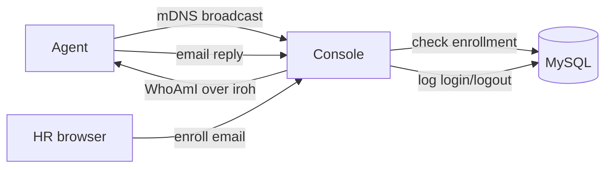

# hrouk

Know who is on your local network.

Agents announce themselves on the LAN. The console asks who they are over an
encrypted connection and checks them against a database that HR
manages. Every login and logout is logged and saved.



## Run

```
docker compose up -d
cargo run -p console
```

Open `http://127.0.0.1:8080` to enroll users.

On a user machine:

```
cargo run -p agent -- --email alice@example.com
```

share your endpoint id to the HR :) 
